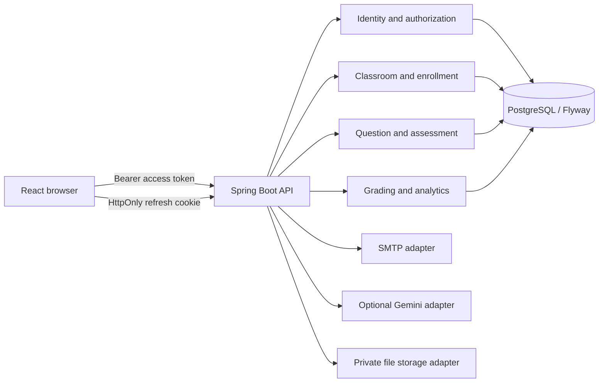

# Architecture

EduTrack is one school system for one ADMIN_TEACHER and many STUDENT/PARENT accounts. It is a modular monolith: Spring Boot owns business rules and PostgreSQL; React is a client of versioned HTTP APIs. There is no multi-tenant boundary or public teacher registration in this release.

## Boundaries

- **Identity:** account lifecycle, credentials, sessions, parent consent and verified links. A database partial unique index enforces one teacher account.
- **Classroom:** class lifecycle and enrollment records. Leaving a class closes an enrollment; it must not erase attempts or scores.
- **Question:** validates eight types and owns the answer key. Student responses never serialize the key.
- **Assessment:** copies a question into an exam snapshot. Assignment eligibility is checked at start and every sensitive read/write.
- **Grading:** objective grading is deterministic; essays require a teacher confirmation. Every changed score is appended to history.
- **AI:** bounded optional provider. Suggestions are stored separately from official grades. Missing configuration is an explicit unavailable state.
- **Analytics:** calculates facts from published results; generated prose must receive only measured facts.
- **Notification/file:** in-app records are written with assignment and publication transactions; private answer attachments are authorized through attempt ownership. A durable email outbox is still planned.

## Code organization

Use `com.edutrack.{identity,classroom,question,assessment,grading,ai,analytics,notification,file,security,common}`. Each HTTP controller maps DTOs and delegates business decisions to a service. DTOs must not expose persistence entities. Transaction boundaries belong to services. The existing `SchoolController` currently includes SQL and business logic and should be refactored as the classroom slice matures; this is architecture debt, not a completed clean layer.

## Data flow for an exam

1. Teacher creates a draft and selects validated questions. Each `exam_questions` row captures the text, options, answer key, rubric and points at that moment.
2. Teacher publishes only after settings and question set validate; an assignment names one class or student.
3. Student starts an eligible attempt. The server computes start/deadline. The browser shows time remaining based on server timestamps and saves answers incrementally.
4. Submission locks the attempt, evaluates objective items once, creates pending essay grades, and records an idempotency key. No later answer edit is accepted.
5. Teacher confirms essay grades and publishes the final result. Parent and student read only results allowed by publication settings.

## Performance and reliability

Use indexed, paginated reads and DTO projections for lists. Avoid eager collections and per-row queries. Use optimistic versions for editable drafts and row locking/unique constraints for submit concurrency. Cache only public or user-scoped data with correct invalidation; never cache an answer-key response for a student route. Email should be queued or sent after commit so SMTP failure cannot silently roll back user creation. Health probes must separate service liveness and database readiness.

## Next slice boundaries and invariants

The current application has exam, attempt, automatic/teacher grading, result detail, parent views, essay attachments, in-app notifications, dashboards, class ranking and student report snapshots. CSV/Excel import reuses the single-student account creation path. `AdminGradingService` still combines provider calls and grading persistence; extracting a provider boundary remains architecture work. Class-wide reporting, durable email outbox and broader notification events remain future work.

- **Results:** `published_at` is the sole release gate for student and parent result APIs. `showResultImmediately` sets that timestamp only when objective grading finishes on submit. `showAnswersAfterSubmit` controls answer-key disclosure after publication. Parent reads additionally require an active verified link at query time.
- **Files:** a private file metadata row binds each blob to a specific answer and attempt. Controllers authorize through that chain before streaming. Storage returns an opaque object key; neither path nor URL is accepted from the browser. Signature/MIME/size checks precede persistence. Cleanup handles a database or storage failure without orphaning sensitive content.
- **Notifications:** assignment and result-publication writes resolve recipients from persisted relationships and create in-app records in the same transaction. A durable email outbox and bounded delivery worker are not yet implemented.
- **Ranking and reports:** live ranking computes from eligible class assignments and published attempts using the documented 70/20/10 formula; private routes return only the caller's own/linked child's row. Weekly/monthly student report snapshots store measured facts for completed UTC periods; PDF/XLSX exports render the stored snapshot. Formula versioning and class-wide snapshots are not yet implemented.
- **AI:** a provider interface returns validated structured output, model ID and latency. A fingerprint of question snapshot, answer version, attachment set and model gives idempotency. Provider output is untrusted data; it cannot write `teacher_score` or publish a result. Missing configuration returns an unavailable state without blocking other modules.

Cross-module access is through services/repositories with narrowly scoped authorization methods. In particular, a generic `getStudent(studentId)` must not become a backdoor for parent or student data. Add integration tests for cross-student access to results, attachments and analytics before exposing the corresponding frontend screens.
