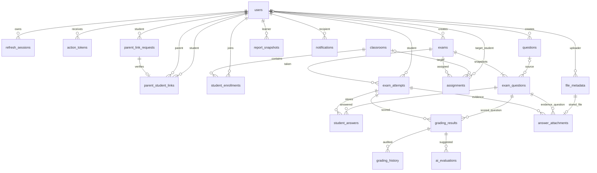

# Entity relationships

This diagram reflects migrations V1–V9. Email outbox, class-wide reports and ranking snapshots are still planned.

The relationship from exam to questions is logically one or more only after publication. A draft can have zero questions. Database constraints enforce keys and uniqueness; publication service must enforce the remaining business condition.
